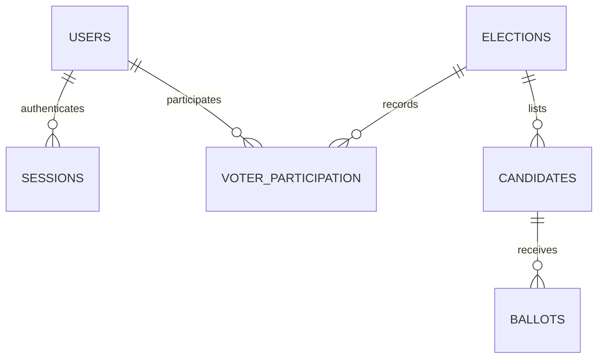

# Online Voting Management System

Campus Ballot shows how a relational database can enforce one ballot per registered account per election and use aggregate queries to publish election results.

## Entity relationship diagram



| Relation | Keys and responsibilities |
| --- | --- |
| users | Primary key id. Unique email, salted password hash and role. |
| sessions | Primary key token_hash. user_id references users. |
| elections | Primary key id. Status check restricts values to draft, open and closed. |
| candidates | Composite primary key (election_id, id). Unique (election_id, name). |
| voter_participation | Composite primary key (election_id, voter_id). Both columns are foreign keys. |
| ballots | Primary key id. Composite foreign key (election_id, candidate_id) restricts the ballot to a candidate from its election. |

Each relation stores facts about its key. Election details and candidate names are stored once in their respective relations. Totals are calculated by the results view. Participation records store which accounts voted. Ballot records store candidate choices and have no voter identifier.

## Vote transaction

The application verifies the voter role, then opens a database transaction. In MySQL it locks the election row with FOR UPDATE, checks its status and validates the candidate. It inserts the participation record and stops if the composite primary key already exists. It then inserts the ballot and commits both writes together. A failure rolls back both writes. The close operation updates the same election row, so closing and accepting a ballot are ordered by the database.

## Example SQL

Show the tally for each closed election, including candidates that received zero ballots. The view uses a LEFT JOIN and counts the matched ballot IDs.

```sql
SELECT e.title, r.name AS candidate, r.votes
FROM election_results AS r
JOIN elections AS e ON e.id = r.election_id
ORDER BY e.title, r.votes DESC, r.name;
```

Count participating accounts per election.

```sql
SELECT e.id, e.title, COUNT(p.voter_id) AS participating_voters
FROM elections AS e
LEFT JOIN voter_participation AS p ON p.election_id = e.id
GROUP BY e.id, e.title
ORDER BY e.title;
```

Check the two tables written by the vote transaction. An empty result means every election has matching participation and ballot counts.

```sql
SELECT id, title
FROM elections AS e
WHERE (SELECT COUNT(*) FROM voter_participation AS p WHERE p.election_id = e.id)
   <> (SELECT COUNT(*) FROM ballots AS b WHERE b.election_id = e.id);
```

## Demo scope

Account registration is self-service and eligibility is based on the registered account. Use fictional elections and accounts for the classroom demonstration.

